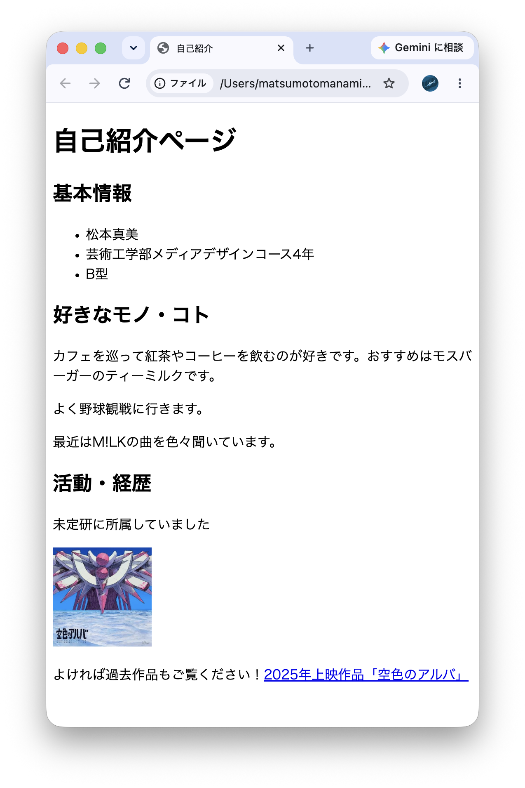

# 21. 複数のHTML要素を用いて自己紹介ページの作成
`<h1>`（見出し），`<p>`（段落），`<ul>・<li>`（リスト），`<a>`（リンク），``（画像）などを用いて，自己紹介ページを作成すること．外部サイト（例：九州大学のWebサイトなど）へのリンクを1つ以上含めること．画像はフリー素材やアイコン等でもよい．``には内容を説明するalt属性を付けること．

```
<!DOCTYPE html>
<html lang="ja">
<head>
  <meta charset="UTF-8">
  <meta name="viewport" content="width=device-width, initial-scale=1">
  <title>自己紹介</title>
</head>
<body>
  

<h1>自己紹介ページ</h1>


<h2>基本情報</h2>
  <ul>
    <li>松本真美</li>
    <li>芸術工学部メディアデザインコース4年</li>
    <li>B型</li>
  </ul>

<h2>好きなモノ・コト</h2>
<p>カフェを巡って紅茶やコーヒーを飲むのが好きです。おすすめはモスバーガーのティーミルクです。</p>
<p>よく野球観戦に行きます。</p>
<p>最近はM!LKの曲を色々聞いています。</p>

<h2>活動・経歴</h2>
<p>未定研に所属していました</p>
<p></p>
<p>よければ過去作品もご覧ください！<a href="https://youtu.be/C2iAzqANcyw?si=IPfuCwp0LRa4CBip">2025年上映作品「空色のアルバ」</a></p>


</body>
</html>
```
### 使用したHTML要素の解説
* **`<h1>`（見出し）**
hの後の数が大きくなるほどテキストサイズが小さくなる。

* **`<p>`（段落）**
まとまったテキストブロックを配置できる。\
`<br>`（改行）を用いる方法もあるが、クローラー（検索エンジンなどにおいて、情報を探すロボットのようなもの）がコンテンツを把握しづらい・デバイスによって見た目にズレが生じるといった問題がある。

* **`<ul>`・`<li>`（リスト）**
`<ul>`は順序なしリスト、`<ol>`は順序ありリストを制作することができる。

* **``（画像 / `alt`属性）**
  `width``height`を用いることでサイズを指定できる。\
  `alt`（画像の代替テキスト）は検索エンジンに適切な画像内容を伝え、コンテンツを検索エンジンやユーザーにわかりやすくする役割を担う

* **`<a>`（リンク）**
外部サイトへのハイパーリンクを設定できる。

### 表示結果



