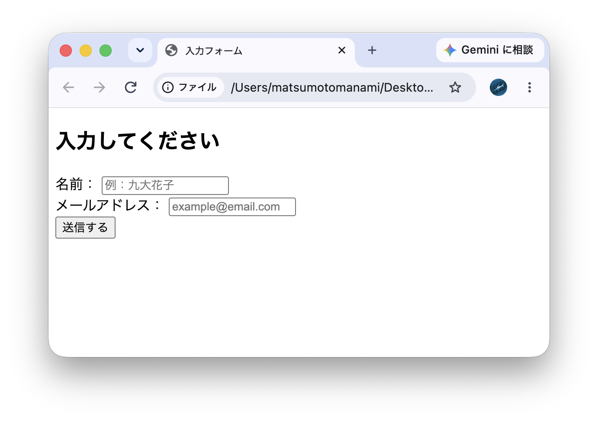
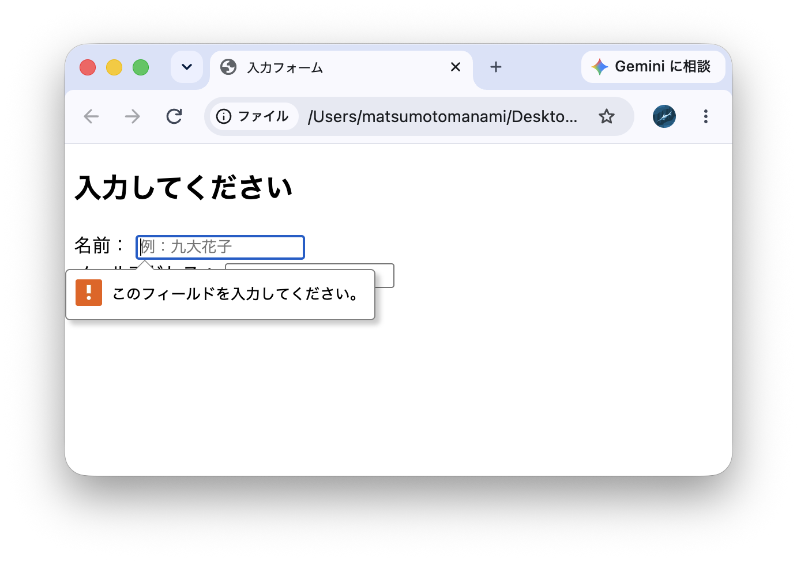
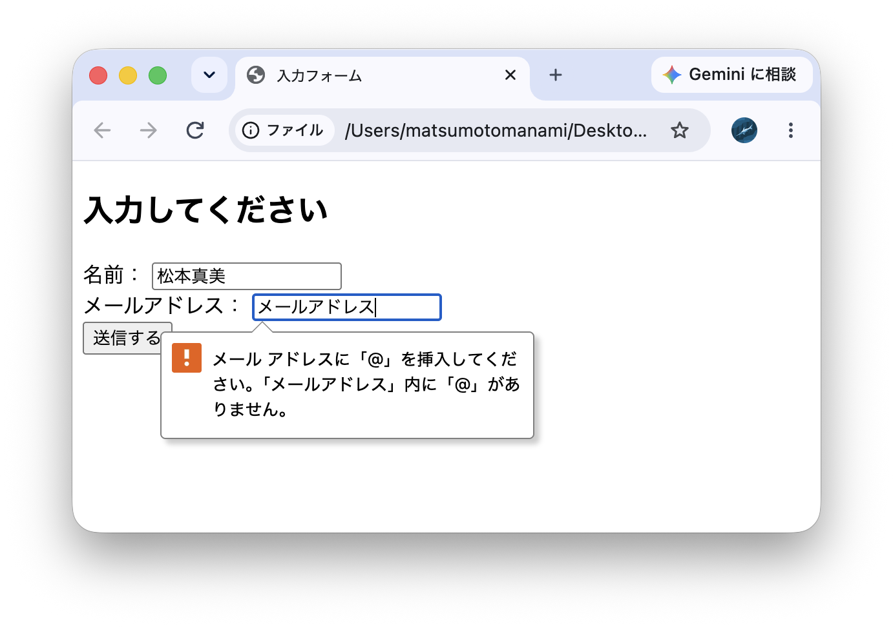

# 24. 入力フォームの作成
名前やメールアドレスを入力できるフォーム（`<form>`タグ＋`<input>`タグ等）を作成すること．
各入力欄に`<label>`を対応付け，type="email"やrequired属性によるブラウザの入力チェックも利用すること．
ボタン（`<button>`または`<input type="submit">`）も追加すること．

```

<!DOCTYPE html>
<html lang="ja">
<head>
  <meta charset="UTF-8">
  <meta name="viewport" content="width=device-width, initial-scale=1">
  <title>入力フォーム</title>
</head>
<body>

  <h2>入力してください</h2>

  <form>
    <div>
      <label for="name">名前：</label>
      <input type="text" id="name" name="user_name" required placeholder="例：九大花子">
    </div>

    <div>
      <label for="email">メールアドレス：</label>
      <input type="email" id="email" name="user_email" required placeholder="example@email.com">
    </div>

    <div>
      <button type="submit">送信する</button>
    </div>
  </form>

</body>
</html>

```

### タグの解説
* **`<form>` （フォームタグ）**\
ユーザーが文字を入力したりボタンを押したりする「入力フォーム全体」を囲む範囲（エリア）を指定するタグ。

* **`<label>` （ラベルタグ）**\
入力欄のタイトルや説明書き（「名前：」や「メールアドレス：」など）を示すタグ。\
`for="name"` のように書くことで、画面上の文字をクリックしたときにも、対応する入力欄に自動でカーソルが当たるようになる。

* **`<input>` （インプットタグ）**\
ユーザーに文字を書き込んでもらうための「入力ボックス」を作るタグ。\
今回は`</input>`を用いない形にしている。

* **`type="text"` （テキストタイプ）**\
普通の文字（日本語や英数字）を自由に自由に入力できるテキストボックスにする指定。

* **`type="email"` （メールタイプ）**
メールアドレスを入力するためのボックスにする指定。ブラウザに「アットマーク（`@`）が入っているか」などの簡易的なチェック機能を持たせる。

* **`required` （リキアド / 必須属性）**
「ここに入力がないと送信できない」という必須チェックをかける属性。未入力のままボタンを押すと、ブラウザが自動でストップをかける。

* **`placeholder="…"` （プレースホルダー属性）**
入力欄のなかにうっすらと見えている例文（例：九大花子）を表示させる属性。文字を打ち始めると消える。

* **`<button type="submit">` （ボタンタグ / サブミット）**
フォームの内容を送信するための決定ボタン。`type="submit"` を指定することで「送信ボタン」としての役割を持つ。

---

### スクリーンショット
\
↓何も入力しないで送信ボタンを押した場合\
\
↓メールアドレスの入力欄にメールアドレス以外のものを入力した場合\

